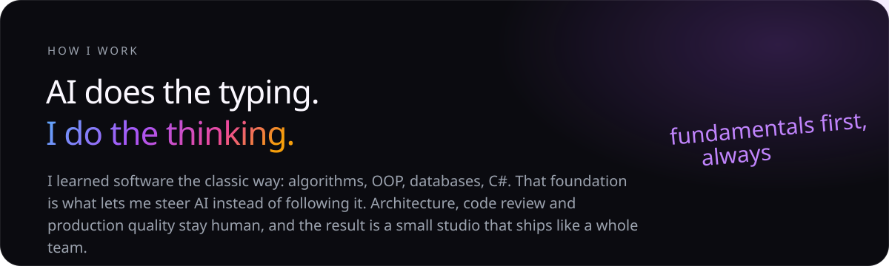
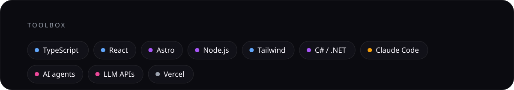

  <a href="https://stchstudio.cz">stchstudio.cz</a>&nbsp;&nbsp;·&nbsp;&nbsp;<a href="https://www.instagram.com/stchstudio.cz/">Instagram</a>&nbsp;&nbsp;·&nbsp;&nbsp;<a href="mailto:info@stchstudio.cz">info@stchstudio.cz</a>

